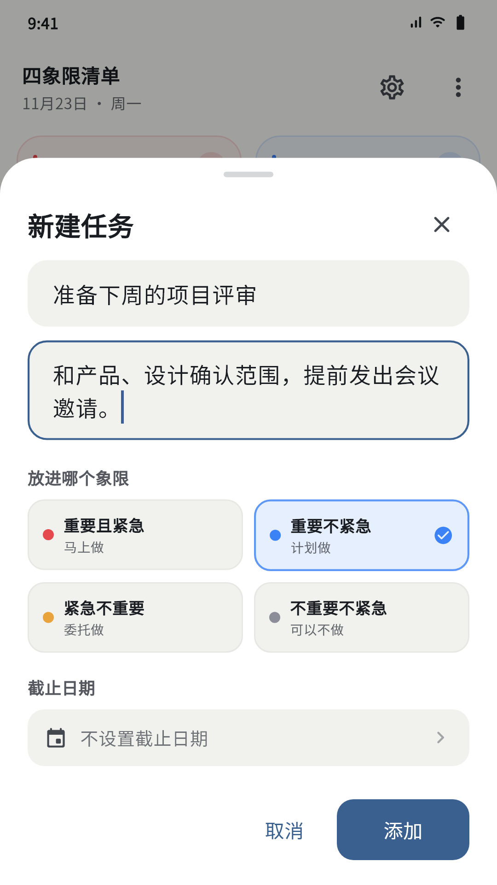

# 四象限清单 · Quadrant List

> 把待办按「重要 / 紧急」分成四格。无广告、零权限、纯本地。

[](#技术栈)
[](#技术栈)
[](#技术栈)
[](LICENSE)
[](#隐私)

「四象限清单」是一款 Android 待办清单应用：首页就是 2×2 的四象限矩阵，一屏看清所有待办。**不用登录、不联网、不申请任何权限**，数据只存在你自己的手机上。

- 仓库：<https://github.com/1304857605-create/quadrant-todo>
- 当前版本：`1.0.0`（versionCode 1）
- 平台：Android 7.0 及以上（minSdk 24，targetSdk 36）
- 协议：GPL-3.0

---

## 目录

- [功能](#功能1000)
- [四象限怎么分](#四象限怎么分)
- [截图](#截图)
- [下载与安装](#下载与安装)
- [从源码构建](#从源码构建)
- [数据与备份](#数据与备份)
- [隐私](#隐私)
- [目录结构](#目录结构)
- [技术栈](#技术栈)
- [路线图](#路线图)
- [参与贡献](#参与贡献)
- [开源协议](#开源协议)
- [联系方式](#联系方式)
- [English Summary](#english-summary)

## 功能（1.0.0）

| 功能 | 说明 |
| --- | --- |
| 四象限矩阵首页 | 2×2 四张卡片，一屏看清全部待办；点卡片进入该象限的完整列表 |
| 待办管理 | 新建、编辑、删除、勾选完成 / 取消完成；字段为标题（必填）、备注（可选）、所属象限、截止日期（可选） |
| 拖动换象限 | 在首页长按任务卡片，拖到其他象限即可调整分类 |
| 完成状态 | 完成的任务显示删除线；可全局「显示已完成」；可一键清除已完成 |
| 四象限详情页 | 进入某个象限的完整列表，新建时自动选中该象限 |
| 深色模式 | 跟随系统 / 浅色 / 深色，在设置页切换 |
| 数据自主 | JSON 导出（复制到剪贴板）与导入（粘贴 JSON），方便备份迁移 |
| 关于页 | 版本号、开源协议、隐私政策、项目主页 |
| 首次使用提示 | 首页可关闭的提示条，说明「长按任务可以拖到别的象限」 |
| 隐私确认 | 首次启动展示隐私政策摘要，同意后方可使用（不收集任何信息） |

> 1.0.0 的功能范围就是上表这些。没有云同步、没有提醒推送、没有账号，也没有广告和统计——不是藏起来了，是没有做。

## 四象限怎么分

采用艾森豪威尔矩阵（重要 × 紧急）把待办分成四格：

| 象限 | 含义 | 建议行动 | 颜色 |
| --- | --- | --- | --- |
| **Q1** 重要且紧急 | 必须现在处理的事 | 马上做 | `#E5484D` 红 |
| **Q2** 重要不紧急 | 值得长期投入的事 | 计划做 | `#3B82F6` 蓝 |
| **Q3** 紧急不重要 | 打断你但不重要的事 | 委托做 / 尽快处理 | `#E8A33D` 琥珀 |
| **Q4** 不重要不紧急 | 可做可不做的事 | 可以不做 | `#8B8D98` 灰 |

四象限没有对错，只有取舍。把一件事放进哪一格，本身就是一次决定；拖动卡片换格，就是在重新排序你的一天。

## 截图

以下截图由 Flutter Widget 测试在 1080×1920 画布上直接渲染，和真机界面一致：

<p align="center">
  
  
  
</p>
<p align="center">
  
  
  
</p>

## 下载与安装

### 应用商店

| 渠道 | 状态 |
| --- | --- |
| 小米应用商店 | 准备中（需企业/组织开发者主体，详见 [docs/STORE_XIAOMI.md](docs/STORE_XIAOMI.md)） |

商店链接、下载量与评分暂不公布，上架后会在本文件更新。

### GitHub Releases

发布后会在此提供 APK 下载：<https://github.com/1304857605-create/quadrant-todo/releases>

1.0.0 的安装包将在正式发布时上传，当前仓库以源码为准。

### 手动安装 APK

1. 确认手机为 Android 7.0 或更高版本；
2. 下载 APK 后，按系统提示允许「安装未知来源应用」（侧载 APK 需要，上架商店后不需要）；
3. 安装完成后打开即可使用，无需注册、无需联网。

## 从源码构建

### 环境要求

| 组件 | 版本 / 说明 |
| --- | --- |
| Flutter | **3.50.1 stable** |
| Dart | **3.14**（随 Flutter 提供，无需单独安装） |
| JDK | **17 或更高**（构建使用 JDK 17 验证） |
| Android SDK | **Platform 36**；编译用 Build-Tools 以 `android/` 配置为准 |
| Android 版本 | minSdk 24（Android 7.0）、targetSdk 36 |
| Gradle / AGP | 以 `android/` 目录内配置为准 |

### 构建步骤

> **中国大陆网络提示**：Flutter 引擎 AAR 默认从 `storage.googleapis.com` 下载，可能会长时间卡住。构建前先设置官方中国镜像：
>
> ```powershell
> $env:FLUTTER_STORAGE_BASE_URL = "https://storage.flutter-io.cn"
> ```
>
> macOS / Linux：`export FLUTTER_STORAGE_BASE_URL=https://storage.flutter-io.cn`
>
> Gradle 发行版与 Maven 依赖若下载慢，可自行临时换成阿里云/腾讯云镜像；**本地镜像配置不要提交到仓库**。

```bash
# 1. 获取代码
git clone https://github.com/1304857605-create/quadrant-todo.git
cd quadrant-todo

# 2. 确认工具链（需输出 Flutter 3.50.1 • Dart 3.14）
flutter --version

# 3. 安装依赖（shared_preferences + material_ui，均为 Flutter 官方包）
flutter pub get

# 4. 静态检查与测试
flutter analyze
flutter test

# 5. 构建 release APK
flutter build apk --release
```

产物路径：`build/app/outputs/flutter-apk/app-release.apk`

如需上架应用商店的 AAB：

```bash
flutter build appbundle --release
# 产物：build/app/outputs/bundle/release/app-release.aab
```

### 关于签名

release 构建需要你自己的签名配置。签名文件与口令**不要提交到仓库**，具体步骤见 [docs/SIGNING.md](docs/SIGNING.md)。未配置签名时，release 构建会回退到 debug 签名，只适合本地测试：

```bash
flutter build apk --debug
```

## 数据与备份

- 所有待办保存在应用私有目录（`SharedPreferences`），App 卸载后随之删除。
- **卸载或换机前请先导出**：在设置页导出 JSON（复制到剪贴板），保存到你能找到的地方。
- **导入**：在设置页粘贴此前导出的 JSON 完成导入。
- 没有账号、没有云同步，因此不存在「登录后自动恢复」。数据在你自己手里，也需要你自己备份。

## 隐私

一句话：**不收集、不上传、不共享任何个人信息。**

- 没有任何 Android 权限（`AndroidManifest.xml` 不声明权限），没有 `INTERNET` 权限，所以应用在系统层面就无法联网。
- 构建出的 release APK 已用 `aapt dump permissions` 验证：**除包名外没有任何 `uses-permission`**（AndroidX 自动合并的签名级内部权限也已用 manifest merger 移除）。
- 没有广告、没有统计埋点、没有崩溃上报、没有第三方统计 SDK。
- 除 Flutter 引擎、官方 UI 包 `material_ui` 与本地存储插件 `shared_preferences` 外，不引入其他第三方依赖。

完整条款见 [PRIVACY.md](PRIVACY.md)（Markdown 版）与 [docs/privacy.html](docs/privacy.html)（可托管到 GitHub Pages 的网页版，用于商店隐私政策链接）。

> 启用 GitHub Pages 时请选择 **main 分支 + 根目录 `/ (root)`**，隐私政策地址为 `https://1304857605-create.github.io/quadrant-todo/docs/privacy.html`；该地址已写入应用内「关于 → 隐私政策」。

## 目录结构

以下为仓库的约定布局，实际文件以仓库内容为准：

```text
quadrant-todo/
├── android/                  # Android 工程，applicationId: cn.sifen.quadrant
├── lib/                      # Dart 源码
│   ├── data/                 # 本地数据仓库（shared_preferences、JSON 导入导出）
│   ├── models/               # 待办、象限数据模型
│   ├── screens/              # 首页、象限详情、设置、关于、隐私政策
│   ├── state/                # 任务与设置的运行时状态
│   ├── theme/                # Material 3 主题与四象限配色
│   ├── utils/                # 日期文案等工具函数
│   ├── widgets/              # 象限卡片、任务项、编辑弹层等组件
│   ├── app.dart              # MaterialApp 根组件
│   ├── app_info.dart         # 名称、版本、仓库地址等元信息
│   └── main.dart             # 入口
├── test/                     # 单元测试 / Widget 测试 / 截图脚本
├── tool/screenshots/         # 截图字体下载说明（字体文件不入库）
├── design/                   # 图标源文件与生成脚本
├── docs/
│   ├── privacy.html          # 隐私政策网页（GitHub Pages）
│   ├── STORE_XIAOMI.md       # 小米应用商店上架说明
│   ├── STORE_LISTING.md      # 商店文案与素材清单
│   ├── PUBLISHING_CHECKLIST.md  # 上架检查清单
│   ├── SIGNING.md            # release 签名说明
│   └── screenshots/          # 应用截图（1080×1920）
├── pubspec.yaml              # 依赖：shared_preferences、material_ui
├── CHANGELOG.md
├── CONTRIBUTING.md
├── LICENSE
└── README.md
```

> 目录会随开发推进略有调整，以仓库实际内容为准。

## 技术栈

| 项 | 值 |
| --- | --- |
| 目标平台 | Android 7.0+（minSdk 24，targetSdk 36） |
| UI | Flutter 3.50.1 stable / Dart 3.14 / Material 3（`material_ui`） |
| 本地存储 | `shared_preferences`（Flutter 官方插件，纯本地） |
| 网络 | 无（不声明 `INTERNET` 权限，无任何网络请求） |
| 权限 | 无 |
| 包名 | Dart 包 `quadrant_list`；Android `cn.sifen.quadrant` |
| 视觉 | 石墨蓝 `#3D5A80`；浅色背景 `#F7F7F5`，深色背景 `#121316`；系统字体 |
| 开源协议 | GPL-3.0 |

## 路线图

1.0.0 只做 Android 端的本地四象限清单。以下方向目前**没有实现，也没有排期**：

| 方向 | 状态 |
| --- | --- |
| 云同步 / 多设备同步 | 暂不考虑（与「纯本地、零权限」的定位冲突） |
| 提醒 / 通知推送 | 暂不考虑（需要通知权限与后台能力） |
| iOS / 桌面端 | 暂不考虑（1.0.0 仅 Android） |
| 日历订阅、多人协作、桌面小组件 | 暂不考虑 |
| 账号体系、内购、广告、统计埋点 | 不做 |

有需求或不同看法，欢迎开 Issue 讨论：<https://github.com/1304857605-create/quadrant-todo/issues>

## 参与贡献

欢迎提交 Issue 与 Pull Request。提交代码前请先读 [CONTRIBUTING.md](CONTRIBUTING.md)，其中包含分支命名、提交信息规范、`flutter analyze` / `flutter test` 要求以及不要提交签名文件等注意事项。

报告问题时请尽量附上：设备型号、Android 版本、应用版本（设置 → 关于），以及可复现的步骤。

## 开源协议

本项目以 **GPL-3.0** 发布，完整协议文本见 [LICENSE](LICENSE)。

你可以自由使用、修改和分发，但分发修改版时需同样以 GPL-3.0 开放源代码，并保留版权与协议声明。

## 联系方式

- 邮箱：<1304857605@qq.com>
- Issue：<https://github.com/1304857605-create/quadrant-todo/issues>
- 仓库：<https://github.com/1304857605-create/quadrant-todo>

## English Summary

**Quadrant List** is a minimal, open-source Android to-do app built with Flutter. It organizes tasks into a 2×2 Eisenhower matrix — important/urgent, important/not-urgent, urgent/not-important, and neither — so you can see everything on one screen.

It has no ads, no tracking, no account system, and requests **no Android permissions** (no `INTERNET` permission either), so it cannot connect to the network. All tasks are stored locally via `shared_preferences`, and can be exported/imported as JSON through the clipboard. Dark mode, drag-to-move tasks between quadrants, a first-launch privacy consent, and a detail page for each quadrant are included in 1.0.0.

Built with Flutter 3.50.1 stable / Dart 3.14 and Material 3, for Android 7.0+ (minSdk 24, targetSdk 36). Released under GPL-3.0. Contributions and issue reports are welcome — see [CONTRIBUTING.md](CONTRIBUTING.md). Contact: <1304857605@qq.com>.

---

<sub>事分四象限，心自有轻重。</sub>
