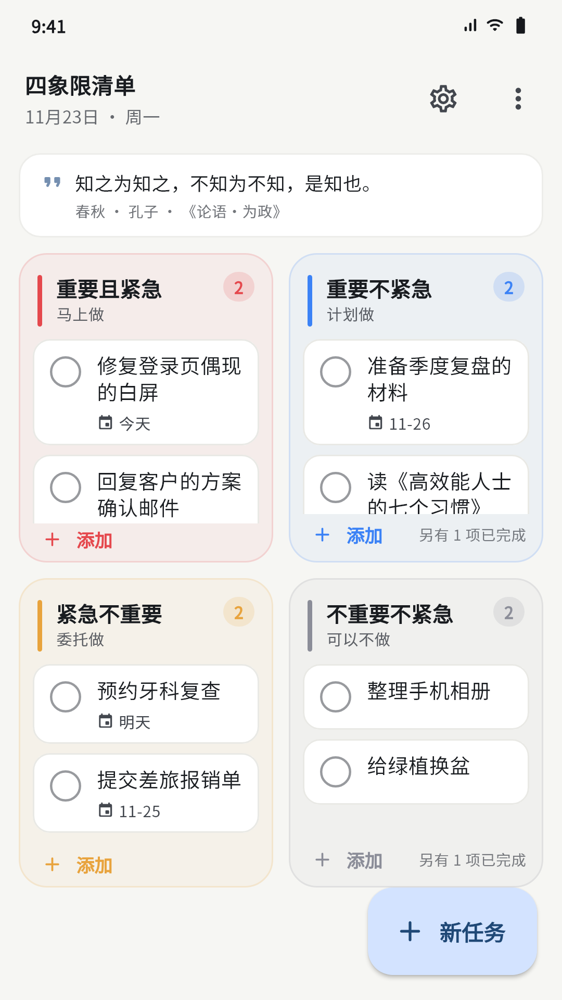
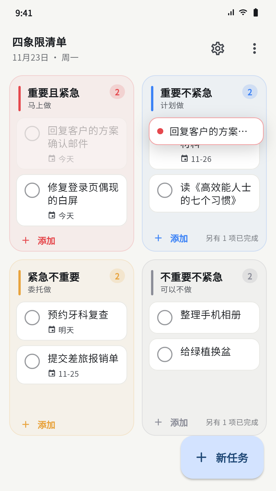
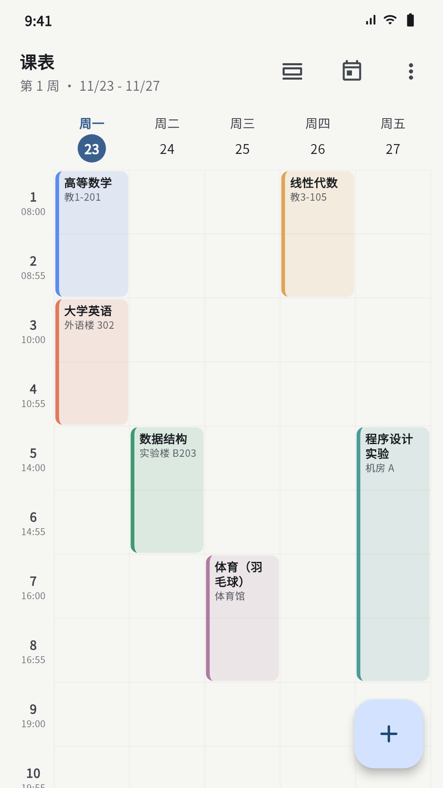
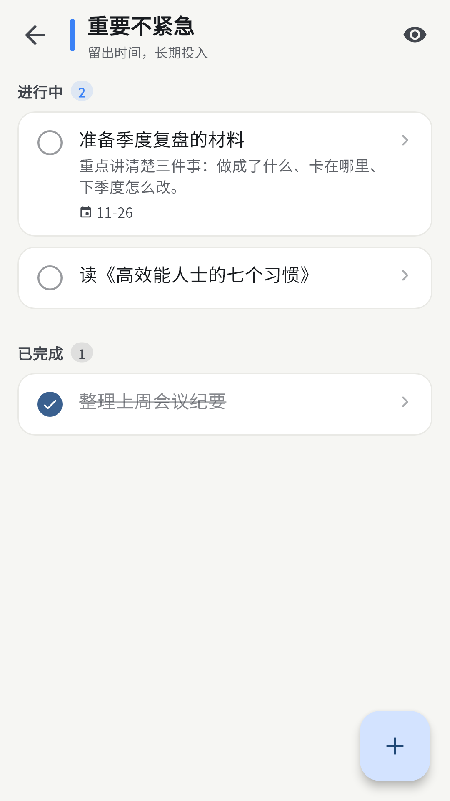
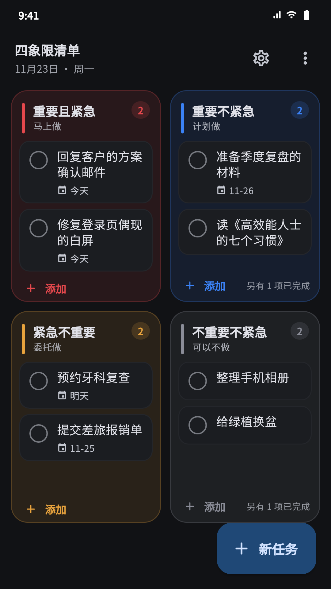
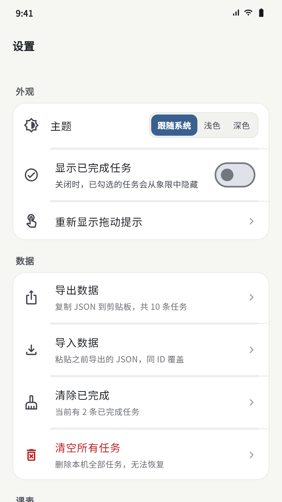

# 四象限清单 · Quadrant List

> 四象限待办 × 课表 × 每日一句。无广告、数据本地、权限可选。

[](#技术栈)
[](#技术栈)
[](#技术栈)
[](LICENSE)
[](#隐私)

「四象限清单」是一款 Android 效率应用：首页是 2×2 的四象限待办矩阵，另外提供课表与每日一句。**不用登录，任务和课表默认只保存在本机**；联网金句与课程提醒都是可选能力，默认关闭。

- 仓库：<https://github.com/1304857605-create/eisenhower-task-android>
- 当前版本：`1.1.0`（versionCode 2）
- 平台：Android 7.0 及以上（minSdk 24，targetSdk 36）
- 协议：GPL-3.0

---

## 目录

- [功能](#功能110)
- [四象限怎么分](#四象限怎么分)
- [课表与每日一句](#课表与每日一句)
- [截图](#截图)
- [下载与安装](#下载与安装)
- [从源码构建](#从源码构建)
- [数据与备份](#数据与备份)
- [隐私](#隐私)
- [目录结构](#目录结构)
- [技术栈](#技术栈)
- [路线图](#路线图)
- [参与贡献](#参与贡献)
- [开源协议](#开源协议)
- [联系方式](#联系方式)
- [English Summary](#english-summary)

## 功能（1.1.0）

| 功能 | 说明 |
| --- | --- |
| 四象限矩阵首页 | 2×2 四张卡片，一屏看清全部待办；点卡片进入该象限的完整列表 |
| 待办管理 | 新建、编辑、删除、勾选完成 / 取消完成；字段为标题（必填）、备注（可选）、所属象限、截止日期（可选） |
| 拖动换象限 | 在首页长按任务卡片，拖到其他象限即可调整分类 |
| 完成状态 | 完成的任务显示删除线；可全局「显示已完成」；可一键清除已完成 |
| 四象限详情页 | 进入某个象限的完整列表，新建时自动选中该象限 |
| 深色模式 | 跟随系统 / 浅色 / 深色，在设置页切换 |
| 数据自主 | 任务以 JSON 导出/导入；课表数据只在本机 |
| 课表周视图 / 日视图 | 左右滑动切换周或天，支持 5/7 天显示、当前周与今天高亮 |
| 课表导入 | ICS / Excel / CSV / Word / HTML 表格，导入前预览；文件仅在本机解析 |
| 课程提醒（可选） | 前一天汇总、课前 10/5 分钟提醒；开启时才申请通知权限 |
| 加入系统日历 | 调用系统日历新建事件界面，不申请日历读写权限 |
| 每日一句 | 304 条公版古诗文，可关闭；可选联网更新，失败自动回退内置内容 |
| 隐私确认 | 首次启动展示隐私政策摘要，同意后方可使用；不收集个人信息 |

> 1.1.0 没有云同步、没有账号、没有广告和统计。PDF 直接解析和高校教务平台账号自动导入在后续版本规划中。

## 四象限怎么分

采用艾森豪威尔矩阵（重要 × 紧急）把待办分成四格：

| 象限 | 含义 | 建议行动 | 颜色 |
| --- | --- | --- | --- |
| **Q1** 重要且紧急 | 必须现在处理的事 | 马上做 | `#E5484D` 红 |
| **Q2** 重要不紧急 | 值得长期投入的事 | 计划做 | `#3B82F6` 蓝 |
| **Q3** 紧急不重要 | 打断你但不重要的事 | 委托做 / 尽快处理 | `#E8A33D` 琥珀 |
| **Q4** 不重要不紧急 | 可做可不做的事 | 可以不做 | `#8B8D98` 灰 |

四象限没有对错，只有取舍。把一件事放进哪一格，本身就是一次决定；拖动卡片换格，就是在重新排序你的一天。

## 课表与每日一句

### 课表

- **导入**：支持 ICS、Excel（.xlsx）、CSV、Word（.docx）、HTML 表格；导入前会显示解析结果，可逐条核对后追加或覆盖。
- **手动录入**：课程名、教师、地点、周几、节次、周次（支持单周/双周/连续周）。
- **查看**：底部「课表」标签，周视图左右滑动切周，日视图左右滑动切天；点课程可编辑、删除或加入系统日历。
- **提醒**：设置 → 课程提醒，开启并授权通知后，可设置前一天汇总时间和课前 10/5 分钟提醒。提醒全部在本机排期。
- **PDF / 教务平台账号自动导入**：当前版本暂未支持。PDF 依赖库存在兼容问题；自动导入各高校平台需要后端与联网合规，后续单独做。
- 导入格式与广东高校适配说明见 [docs/COURSE_IMPORT_GUIDE.md](docs/COURSE_IMPORT_GUIDE.md)。

### 每日一句

- 首页顶部卡片显示，内置 304 条公版古诗文（唐诗宋词/诗经/古文等），标明作者与出处。
- 默认离线；可在设置中关闭显示，或开启「联网更新金句」（今日诗词 API，失败自动回退内置内容）。
- 不收录近现代报纸/网络/歌词内容，避免版权风险。

## 截图

以下截图由 Flutter Widget 测试在 1080×1920 画布上直接渲染，和真机界面一致：

<p align="center">
  
  
  
  
</p>
<p align="center">
  
  
  
</p>

## 下载与安装

### 应用商店

| 渠道 | 状态 |
| --- | --- |
| 小米应用商店 | 准备中（需企业/组织开发者主体，详见 [上架最短路径](docs/STORE_QUICKSTART.md)） |

商店链接、下载量与评分暂不公布，上架后会在本文件更新。

### GitHub Releases

**v1.1.0 APK 已发布：** <https://github.com/1304857605-create/eisenhower-task-android/releases/download/v1.1.0/app-release.apk>

- 文件：`app-release.apk`，64,628,044 字节（约 61.6 MiB）
- SHA-256：`921629D6BF74D4DD10328D2E91AE3B686A8536F6D7AF3A2B8197E3AF8FCB5B6A`
- 使用 release 证书签名（证书 SHA-256 见 [docs/SIGNING.md](docs/SIGNING.md)）
- 权限（均可选功能使用，不读取通讯录/位置/相册/相机/日历）：`INTERNET`（联网金句）、`POST_NOTIFICATIONS`（课程提醒）、`RECEIVE_BOOT_COMPLETED`（重启恢复提醒）、`VIBRATE`
- `minSdk 24`、`targetSdk 36`

Release 页面：<https://github.com/1304857605-create/eisenhower-task-android/releases/tag/v1.1.0>

> 1.0.0 的纯离线零权限版本仍保留在 Releases，可在需要“完全无网络权限”时使用。

### 手动安装 APK

1. 确认手机为 Android 7.0 或更高版本；
2. 下载 APK 后，按系统提示允许「安装未知来源应用」（侧载 APK 需要，上架商店后不需要）；
3. 安装完成后打开即可使用，无需注册；任务和课表数据只保存在本机。
4. 下载后可用 `certutil -hashfile app-release.apk SHA256`（Windows）或 `sha256sum`（macOS/Linux）核对上面的哈希。

## 从源码构建

### 环境要求

| 组件 | 版本 / 说明 |
| --- | --- |
| Flutter | **3.50.1 stable** |
| Dart | **3.14**（随 Flutter 提供，无需单独安装） |
| JDK | **17 或更高**（构建使用 JDK 17 验证） |
| Android SDK | **Platform 36**；编译用 Build-Tools 以 `android/` 配置为准 |
| Android 版本 | minSdk 24（Android 7.0）、targetSdk 36 |
| Gradle / AGP | 以 `android/` 目录内配置为准 |

### 构建步骤

> **中国大陆网络提示**：Flutter 引擎 AAR 默认从 `storage.googleapis.com` 下载，可能会长时间卡住。构建前先设置官方中国镜像：
>
> ```powershell
> $env:FLUTTER_STORAGE_BASE_URL = "https://storage.flutter-io.cn"
> ```
>
> macOS / Linux：`export FLUTTER_STORAGE_BASE_URL=https://storage.flutter-io.cn`
>
> Gradle 发行版与 Maven 依赖若下载慢，可自行临时换成阿里云/腾讯云镜像；**本地镜像配置不要提交到仓库**。

```bash
# 1. 获取代码
git clone https://github.com/1304857605-create/eisenhower-task-android.git
cd eisenhower-task-android

# 2. 确认工具链（需输出 Flutter 3.50.1 • Dart 3.14）
flutter --version

# 3. 安装依赖（Flutter 官方包 + 文件导入/通知/网络等开源包）
flutter pub get

# 4. 静态检查与测试
flutter analyze
flutter test

# 5. 构建 release APK
flutter build apk --release
```

产物路径：`build/app/outputs/flutter-apk/app-release.apk`

如需上架应用商店的 AAB：

```bash
flutter build appbundle --release
# 产物：build/app/outputs/bundle/release/app-release.aab
```

### 关于签名

release 构建需要你自己的签名配置。签名文件与口令**不要提交到仓库**，具体步骤见 [docs/SIGNING.md](docs/SIGNING.md)。未配置签名时，release 构建会回退到 debug 签名，只适合本地测试：

```bash
flutter build apk --debug
```

## 数据与备份

- 待办、课表、学期配置与提醒设置都保存在应用私有目录（`SharedPreferences`），App 卸载后随之删除。
- **卸载或换机前请先导出任务**：在设置页导出 JSON（复制到剪贴板），保存到你能找到的地方；课程目前需要重新导入。
- **导入任务**：在设置页粘贴此前导出的 JSON 完成导入。
- 没有账号、没有云同步，因此不存在「登录后自动恢复」。数据在你自己手里，也需要你自己备份。

## 隐私

一句话：**不收集任务与课表内容，没有账号，数据默认只在本机。**

- 任务、课表、学期和提醒设置保存在本机 `SharedPreferences`，不上传。
- 权限只用于可选功能：
  - `INTERNET`：仅在开启「联网更新金句」时请求今日诗词 API；
  - `POST_NOTIFICATIONS`：仅在开启课程提醒时申请；
  - `RECEIVE_BOOT_COMPLETED`：重启后恢复提醒；
  - `VIBRATE`：通知振动。
- 不读取通讯录、位置、相册、麦克风、相机或日历；没有广告、统计、崩溃上报 SDK。
- “加入系统日历”走系统日历的新建事件界面，不申请日历读写权限。
- 关闭联网金句后应用不会发起网络请求；关闭课程提醒后会取消本地通知。

完整条款见 [PRIVACY.md](PRIVACY.md)（Markdown 版）与 [docs/privacy.html](docs/privacy.html)（可托管到 GitHub Pages 的网页版，用于商店隐私政策链接）。

> 启用 GitHub Pages 时请选择 **main 分支 + 根目录 `/ (root)`**，隐私政策地址为 `https://1304857605-create.github.io/eisenhower-task-android/docs/privacy.html`；该地址已写入应用内「关于 → 隐私政策」。

## 目录结构

以下为仓库的约定布局，实际文件以仓库内容为准：

```text
eisenhower-task-android/
├── android/                  # Android 工程，applicationId: cn.sifen.quadrant
├── lib/                      # Dart 源码
│   ├── course/               # 课表：模型、导入解析、状态、UI、通知、日历桥
│   ├── quotes/               # 每日一句：数据、状态、首页卡片
│   ├── data/                 # 任务本地数据仓库（shared_preferences、JSON 导入导出）
│   ├── models/               # 待办、象限数据模型
│   ├── screens/              # 主框架、四象限首页、设置、关于、隐私政策
│   ├── state/                # 任务与设置的运行时状态
│   ├── theme/                # Material 3 主题与四象限配色
│   ├── utils/                # 日期文案等工具函数
│   ├── widgets/              # 象限卡片、任务项、编辑弹层等组件
│   ├── app.dart              # MaterialApp 根组件
│   ├── app_info.dart         # 名称、版本、仓库地址等元信息
│   └── main.dart             # 入口
├── assets/quotes/            # 每日一句公版数据（304 条）
├── test/                     # 单元测试 / Widget 测试 / 截图脚本
├── tool/screenshots/         # 截图字体下载说明（字体文件不入库）
├── design/                   # 图标源文件与生成脚本
├── docs/
│   ├── privacy.html          # 隐私政策网页（GitHub Pages）
│   ├── STORE_XIAOMI.md       # 小米应用商店上架说明
│   ├── STORE_QUICKSTART.md   # 上架最短路径
│   ├── STORE_LISTING.md      # 商店文案与素材清单
│   ├── PUBLISHING_CHECKLIST.md  # 上架检查清单
│   ├── SIGNING.md            # release 签名说明
│   └── screenshots/          # 应用截图（1080×1920）
├── pubspec.yaml
├── CHANGELOG.md
├── CONTRIBUTING.md
├── LICENSE
└── README.md
```

> 目录会随开发推进略有调整，以仓库实际内容为准。

## 技术栈

| 项 | 值 |
| --- | --- |
| 目标平台 | Android 7.0+（minSdk 24，targetSdk 36） |
| UI | Flutter 3.50.1 stable / Dart 3.14 / Material 3（`material_ui`） |
| 本地存储 | `shared_preferences`（任务/课表/设置，纯本地） |
| 网络 | 仅“联网更新金句”使用 `http` 请求今日诗词 API，可关闭 |
| 权限 | `INTERNET`、`POST_NOTIFICATIONS`、`RECEIVE_BOOT_COMPLETED`、`VIBRATE`，均为可选功能 |
| 课表导入 | ICS / XLSX / CSV / DOCX / HTML（本机解析；PDF 暂未支持） |
| 提醒 | `flutter_local_notifications` + `timezone`，仅本地排期 |
| 包名 | Dart 包 `quadrant_list`；Android `cn.sifen.quadrant` |
| 视觉 | 石墨蓝 `#3D5A80`；浅色背景 `#F7F7F5`，深色背景 `#121316`；系统字体 |
| 开源协议 | GPL-3.0 |

## 路线图

1.1.0 在四象限清单基础上加入了课表与每日一句。后续方向：

| 方向 | 状态 |
| --- | --- |
| PDF 课表直接解析 | 计划中（依赖库兼容问题待解决） |
| 广东高校教务平台账号自动导入 | 规划中；需要后端、各校接口适配与联网合规，单独版本 |
| 课程表导出 Excel / ics | 计划中 |
| 云同步 / 多设备同步 | 暂不考虑（与“数据默认本地”的定位冲突） |
| iOS / 桌面端 | 暂不考虑（当前仅 Android） |
| 账号体系、内购、广告、统计埋点 | 不做 |

有需求或不同看法，欢迎开 Issue 讨论：<https://github.com/1304857605-create/eisenhower-task-android/issues>

## 参与贡献

欢迎提交 Issue 与 Pull Request。提交代码前请先读 [CONTRIBUTING.md](CONTRIBUTING.md)，其中包含分支命名、提交信息规范、`flutter analyze` / `flutter test` 要求以及不要提交签名文件等注意事项。

报告问题时请尽量附上：设备型号、Android 版本、应用版本（设置 → 关于），以及可复现的步骤。

## 开源协议

本项目以 **GPL-3.0** 发布，完整协议文本见 [LICENSE](LICENSE)。

你可以自由使用、修改和分发，但分发修改版时需同样以 GPL-3.0 开放源代码，并保留版权与协议声明。

## 联系方式

- 邮箱：<1304857605@qq.com>
- Issue：<https://github.com/1304857605-create/eisenhower-task-android/issues>
- 仓库：<https://github.com/1304857605-create/eisenhower-task-android>

## English Summary

**Quadrant List** is a minimal, open-source Android productivity app built with Flutter: a 2×2 Eisenhower matrix for todos, a weekly timetable you can swipe through, and a daily line of classical Chinese poetry.

Tasks and courses stay on the device via `shared_preferences`; tasks can be exported/imported as JSON through the clipboard. Course files (ICS / Excel / CSV / Word / HTML) are parsed locally, and optional local notifications can remind you the day before and 10/5 minutes before class. The daily quote uses 304 public-domain classical poems offline, with an optional online refresh via a poetry API. There are no ads, no tracking, no accounts, and no data collection. Android permissions are only used for these optional features (network for online quotes, notifications for reminders); the app never reads contacts, location, photos, camera, or calendar.

Built with Flutter 3.50.1 stable / Dart 3.14 and Material 3, for Android 7.0+ (minSdk 24, targetSdk 36). Released under GPL-3.0. Contributions and issue reports are welcome — see [CONTRIBUTING.md](CONTRIBUTING.md). Contact: <1304857605@qq.com>.

---

<sub>事分四象限，心自有轻重。</sub>
