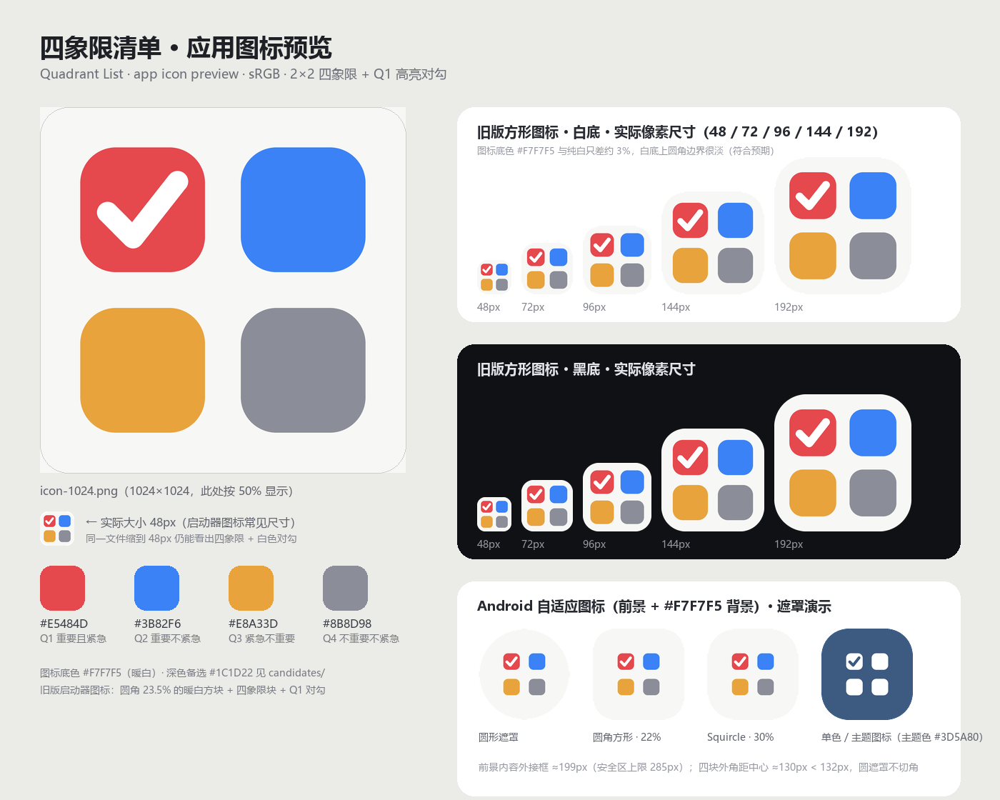

# 四象限清单 · 应用图标设计说明

> 目录：`design/`　｜　产品基线：`README.md` 与 `docs/STORE_LISTING.md`（视觉基调）
> 生成日期：2026-11-22　｜　全部位图为 PNG、内嵌 sRGB ICC profile

---

## 1. 设计概念：「四格 · 一勾」



- **四格** = 2×2 四块圆角方块，直接对应首页的四象限卡片矩阵；四块颜色即 SPEC 的四象限色（Q1 红 / Q2 蓝 / Q3 琥珀 / Q4 灰）。
- **一勾** = 左上 Q1（重要且紧急）块内的白色粗对勾。「已勾掉 / 马上做」既是清单类应用最直接的母题，也让图标在小尺寸下一眼可辨。
- **识别点**：不是"一张四色方格贴图"——白色对勾把"分类矩阵"变成"待办清单"，同时红色块天然承担视觉焦点。

### 为什么 Q1 不做放大 / 错位（关键取舍）

候选方案里试过「Q1 放大 10%~18% + 向外推」（见 `candidates/candidate-b-*`、`candidate-f-*`）。
结论：**在 48px 下，块与块尺寸不一致会被读成"画歪了"，而不是"Q1 高亮"**，且四块的重心失衡。
最终采用**等尺寸对称网格**，「高亮」交给"红色 + 白色对勾"完成——对称在 16~48px 区间最稳，也最贴合 Material 3 的极简、克制。

### 底色

暖白 `#F7F7F5`，与应用浅色背景（SPEC 3 节）完全一致：留白、干净，在深色启动器/深色截图上反差强烈。
深色备选 `#1C1D22`（石墨）已出图（`candidates/candidate-c-dark-equal-check-1024.png`），若商店/运营想要更强冲击力，改一个参数即可切换（见第 7 节），无需改代码。

---

## 2. 配色

| 用途 | 色值 | 说明 |
| --- | --- | --- |
| 图标底色 | `#F7F7F5` | 暖白，同应用浅色背景 |
| Q1 重要且紧急 | `#E5484D` | 同时是"高亮块" |
| Q2 重要不紧急 | `#3B82F6` | |
| Q3 紧急不重要 | `#E8A33D` | |
| Q4 不重要不紧急 | `#8B8D98` | |
| 对勾 | `#FFFFFF` | 纯白，在红色上对比度最高 |
| 深色备选底 | `#1C1D22` | 仅候选图使用 |

---

## 3. 几何规范（全部为相对比例，可任意尺寸复现）

| 项目 | 取值 | 1024px 实际 | 48px 实际 |
| --- | --- | --- | --- |
| 内容外接框（占画布） | 0.780 | ≈ 802px | ≈ 37px |
| 块间缝隙（占画布） | 0.098 | ≈ 100px | ≈ 4.7px |
| 圆角半径 / 块边长 | 0.285 | ≈ 106px | ≈ 5px |
| 旧版启动器图标圆角 | 0.235（占整图） | — | ≈ 11px |
| 对勾半跨度 / Q1 块边长 | 0.310 | — | — |
| 对勾线宽 / Q1 块边长 | 0.170（圆头 + 圆角转折） | — | — |

- **对勾光学居中**：白色包围盒与 Q1 块中心对齐（测得上下/左右边距差 ≤1px），不是简单按几何中心画。
- **小尺寸光学微调（脚本自动，≤96px 生效）**：缝隙放大约 4~5%、圆角收小约 2~3%、勾线加粗约 2~4%，避免降采样后缝隙糊死、对勾变细。
- 图形为纯色实心 + 圆角，**无文字、无渐变、无阴影、无描边**。

---

## 4. Android 自适应图标

| 指标 | 数值 | 结论 |
| --- | --- | --- |
| 前景内容外接框（几何） | **≈199px**（432 画布） | ≤ 285px 安全区上限 ✅ |
| 前景内容外接框（含 1px 抗锯齿羽边） | ≈204px | 同上 ✅ |
| 四块最外角距画布中心 | **≈130.9px** | < 132px（66dp 安全圆半径） ✅ |
| 背景 | 纯色 `#F7F7F5` 满版 432×432 | 无内容 ✅ |

> 说明：任务要求"内容在中心约 66% 安全区（≈285px）内"。**四块形状的外角必须同时落在 264px 安全圆内**，否则圆形遮罩会切掉四块的外圆角——所以前景内容实际取到 199px（仍是"限制在安全区内"，且比上限更保守）。圆形 / 圆角方形 / squircle 三种遮罩的演示见 `icon-preview.png` 右下。

- 单色层（Android 13 主题图标）：纯白剪影 + **对勾透明挖空**（图形内 1041 个透明像素），主题色着色后对勾由底色透出。
- 旧版方形图标：暖白圆角方块（23.5%）+ 四象限块 + 对勾，四角透明。

---

## 5. 文件清单

| 文件 | 尺寸 | 模式 | 用途 |
| --- | --- | --- | --- |
| `icon-1024.png` | 1024×1024 | RGB | 商店图标主文件（满版方形，商店自行切圆角） |
| `icon-512.png` | 512×512 | RGB | 商店/网页通用尺寸 |
| `adaptive-foreground-432.png` | 432×432 | RGBA | 自适应图标前景层（透明） |
| `adaptive-background-432.png` | 432×432 | RGB | 自适应图标背景层（纯 `#F7F7F5`） |
| `monochrome-432.png` | 432×432 | RGBA | Android 13 主题图标单色层（透明） |
| `mipmap-mdpi/ic_launcher.png` | 48×48 | RGBA | 旧版启动器图标 |
| `mipmap-hdpi/ic_launcher.png` | 72×72 | RGBA | 同上 |
| `mipmap-xhdpi/ic_launcher.png` | 96×96 | RGBA | 同上 |
| `mipmap-xxhdpi/ic_launcher.png` | 144×144 | RGBA | 同上 |
| `mipmap-xxxhdpi/ic_launcher.png` | 192×192 | RGBA | 同上 |
| `icon-preview.png` | 1400×1120 | RGB | 预览：1024 大图 + 48px 实际大小（白底/黑底）+ 自适应遮罩 + 色板 |
| `generate_icon.py` | — | — | 生成脚本（唯一入口，可重复运行） |
| `candidates/` | — | — | 候选方案留档（见第 8 节） |

候选目录内容：

| 文件 | 内容 |
| --- | --- |
| `candidate-{a..g}-*-1024.png` | 7 个 1024 候选方案 |
| `gallery-1024.png` | 候选总览墙（3 列缩略图） |
| `candidates-48px.png` | 每个候选的 48px 实际尺寸（白底/黑底）+ 4× 最近邻放大 |

---

## 6. 如何重新生成

```powershell
cd design
python generate_icon.py
```

- 只依赖 **Pillow**（当前 12.3.0）；不联网、无随机数、参数全部固定。
- ICC 头部时间戳已固定 → **连续两次运行输出字节级一致**（22 张 PNG 的 SHA-256 完全相同，已验证）。
- 字体仅用于 `icon-preview.png` 的标注（优先 `C:\Windows\Fonts\msyh.ttc`，缺失时自动回退，不影响图标本身）。
- 输出目录：`design/` 及其 `candidates/`、`mipmap-*/` 子目录（脚本会自动创建）。

### 抗锯齿与"脏边"处理

1. 每个尺寸先按 **4×（>512px）/ 8×（≤512px）超采样**绘制，再降采样；小尺寸另有光学微调。
2. 透明图（前景/单色/旧版圆角图标）降采样走 **预乘 alpha → LANCZOS → 反预乘** 流程。
   普通 RGBA 直接缩放会把透明像素的黑色混进边缘，产生 1px 暗边；预乘后可保证边缘半透明像素的颜色仍是纯块色（已用逐像素校验，`alpha≥32` 的过渡像素与实色色差仅为 LANCZOS 过冲，肉眼不可见）。

---

## 7. 参数与可调项

所有设计参数集中在 `generate_icon.py` 顶部的 `DESIGN` 字典（`design()` 可覆盖）：

| 参数 | 默认 | 含义 |
| --- | --- | --- |
| `content` | 0.780 | 四块外接框占画布比例（带底色图标用 0.78） |
| `gap` | 0.098 | 块间缝隙占画布比例 |
| `radius` | 0.285 | 圆角 / 块边长 |
| `q1_scale` / `q1_shift` | 1.0 / 0.0 | Q1 放大 / 外推（最终方案为 0，即等块） |
| `check` | True | 是否画 Q1 白色对勾 |
| `check_span` / `check_stroke` | 0.310 / 0.170 | 对勾半跨度 / 线宽（相对 Q1 块边长） |
| `mute` | 0.0 | 非 Q1 块向底色混合比例（视觉降级用，最终未启用） |
| `background` | `#F7F7F5` | 图标底色 |

- 最终选型：`FINAL = design()`（脚本内 `FINAL` 常量）。
- **切换深色底**：把 `FINAL = design()` 改成 `FINAL = design(background=GRAPHITE)` 后重跑；`DESIGN["background"]`、预览中的底色说明也需同步（候选 c 已验证该方向出图正常）。
- 自适应前景比例：`ADAPTIVE_CONTENT = 0.460`（若改动 `gap`/`radius`，需重新核对"外角距中心 ≤132px"这条约束，脚本注释里给了计算公式 0.654 × 内容宽）。

---

## 8. 候选方案与选型理由

| 候选 | 方向 | 结论 |
| --- | --- | --- |
| a `baseline-equal` | 四等块、无对勾（对照组） | 辨识度不足，像配色表 |
| b `lift-check` | Q1 放大 10% + 外推 + 对勾 | 48px 下块大小不均，读作"画歪"，淘汰 |
| c `dark-equal-check` | 石墨 `#1C1D22` 底 + 对勾 | 对比强、够精致，**保留为备选底色** |
| **d `equal-check`** | **等块 + Q1 白色对勾** | **最终选型**：对称、48px 最清晰、遮罩不切角 |
| e `muted-others` | 其余三块混白 10% 弱化 | 颜色发灰，违背四象限色规范，淘汰 |
| f `strong-lift-check` | Q1 放大 18% + 大幅外推 | 重心明显失衡，淘汰 |
| g `wide-gap-check` | 缝隙 12% | 四块过散，"矩阵"感减弱，淘汰 |

评审方法：每个候选都渲染 1024 原图 + **48px 实际尺寸** + 4× 最近邻放大（`candidates/candidates-48px.png`），只以 48px 可读性做取舍。

### 迭代记录

1. 第 1 轮：3 个方向（纯几何 / 放大 Q1 / 深色底），48px 评审发现"放大 Q1"在小尺寸下失衡。
2. 第 2 轮：补 4 个探索方向（等块带勾、弱化陪伴块、强放大、宽缝隙），确定"等块 + 对勾"。
3. 第 3 轮：内容比例 74.5% → 78%（商店图标更饱满）；对勾包围盒光学居中（修正 5.5px 右偏）；透明图改预乘 alpha 降采样消除暗边；修正 ICC 时间戳保证可复现。

---

## 9. Android 集成提示（供 Lead / 开发参考，本目录未改任何代码）

- 旧版图标：把 `mipmap-*/ic_launcher.png` 放到 `android/app/src/main/res/mipmap-*dpi/`。
- 自适应图标（API 26+）：`res/mipmap-anydpi-v26/ic_launcher.xml`：

```xml
<adaptive-icon xmlns:android="http://schemas.android.com/apk/res/android">
    <background android:drawable="@color/ic_launcher_background" />
    <foreground android:drawable="@mipmap/ic_launcher_foreground" />
    <!-- Android 13+ 主题图标（可选） -->
    <monochrome android:drawable="@mipmap/ic_launcher_monochrome" />
</adaptive-icon>
```

- 建议把 `adaptive-foreground-432.png` / `monochrome-432.png` 放到 `res/drawable-nodpi/`（432px 已按 108dp@4x 出图，避免被密度缩放二次插值），`ic_launcher_background` 在 `colors.xml` 里定义为 `#F7F7F5`。
- 商店（小米）图标用 `icon-1024.png` / `icon-512.png` 的 **满版方形**，圆角由商店端裁切，不要自行加圆角。

---

## 10. 自检记录（2026-11-22）

- 尺寸/色彩模式：11 个交付 PNG 全部通过（1024/512/432/432/432/48/72/96/144/192 + 预览）。
- 小尺寸：48px 实际渲染清晰，四象限与对勾均可辨认（见 `candidates/candidates-48px.png`）。
- 自适应安全区：内容 199px（上限 285px），外角 130.9px < 132px，圆形遮罩不切角（`icon-preview.png` 右下三种遮罩可复核）。
- 边缘：透明图边缘半透明像素颜色 = 纯块色（预乘 alpha 流程），无暗边/脏边；无阴影。
- 复现：`generate_icon.py` 连续运行两次，22 张 PNG 字节完全一致。
